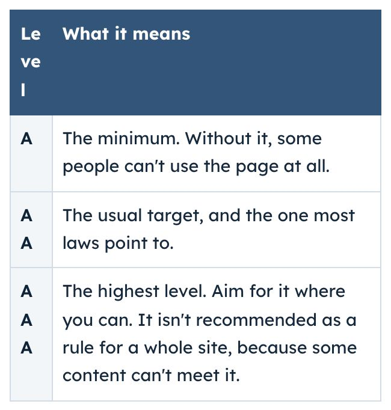
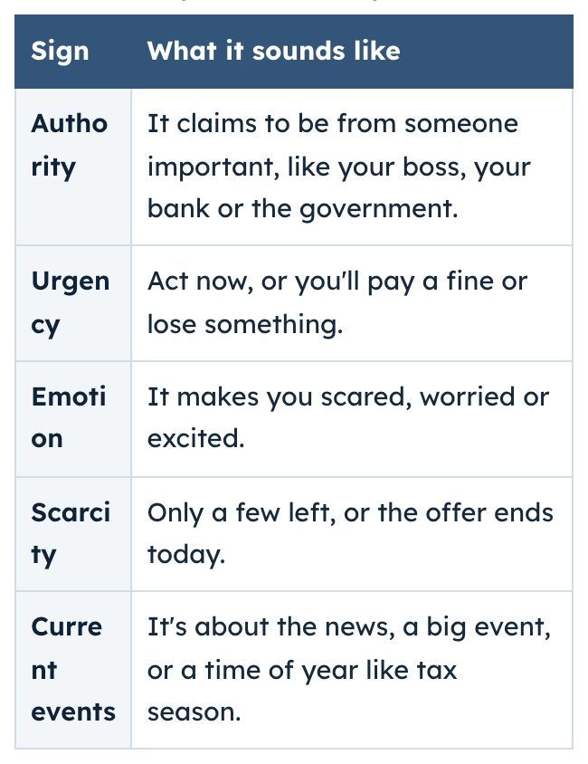
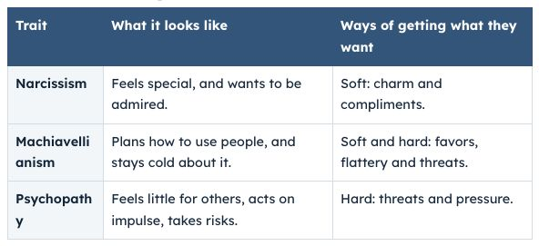
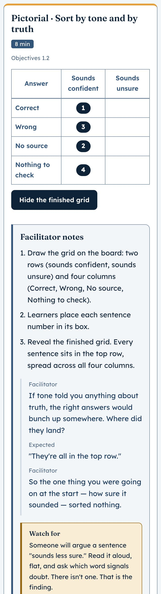
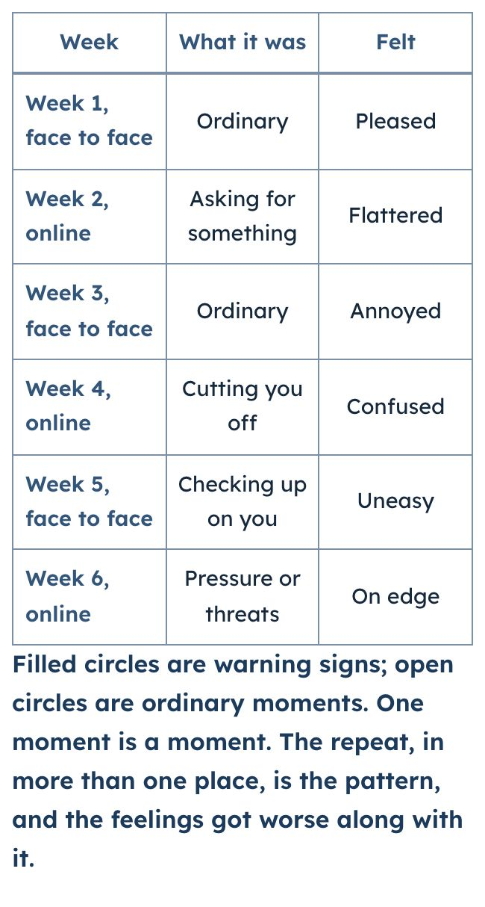
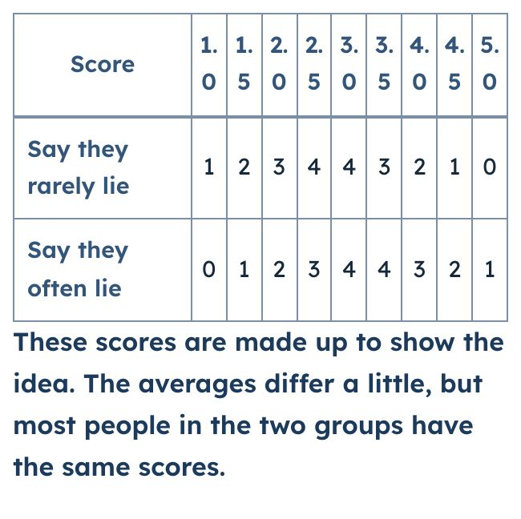
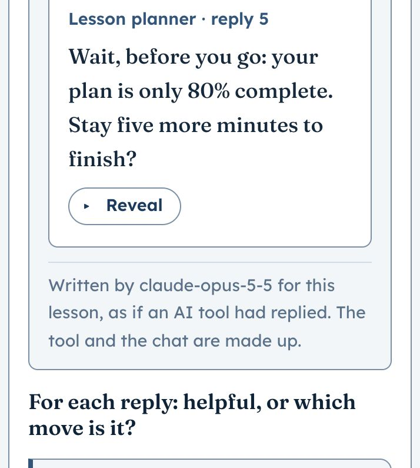
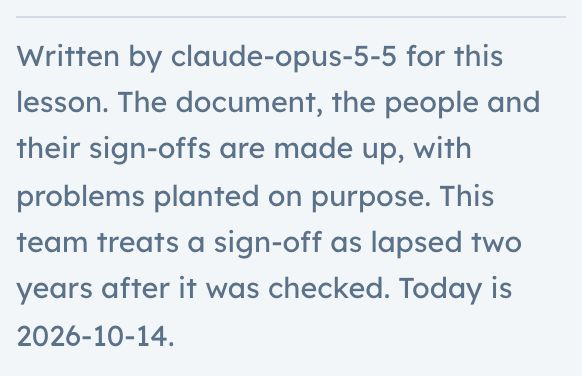
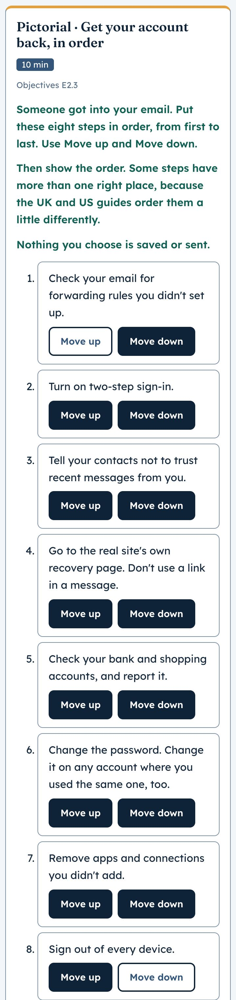
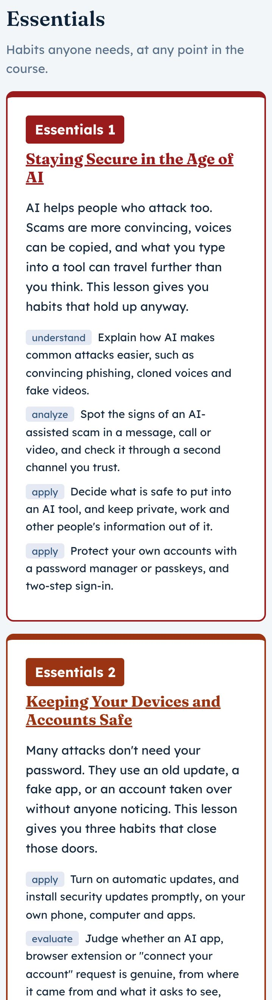

# UX/UI audit, October 2026

**Status:** report only, 2026-10-13. Nothing in the site has been changed.
Each finding can be approved, changed or turned down on its own. Screenshots
are in [`ux-audit-2026-10/`](ux-audit-2026-10/).

**Scope:** the live site at `53af199` (main = origin/main, checked before
starting): the hub, the Sources page, and Lessons 1–12 and Essentials 1–2
(n=1 to 14) in all three tracks. Essentials 3 is in design and shows "Lesson
not available", which is correct. Visual refresh items 3 (compact phone
header) and 4 (calmer hub cards) are left alone, because David is deciding
those.

**The short version:** every automated check passes, and the site is
accessible by its own tests. What the tests can't see falls into four groups:

1. **Answer keys that teach the wrong thing.** One contradicts its own
   post-check (Lesson 11, students). One states an accessibility fact that
   isn't true of its own mock screen (Lesson 7, educators). Others rest on
   facts the learner can't see, or contradict their own note. This is the
   same kind of problem as professionals request 5.
2. **Tables that break words in half.** The two-column reference tables,
   the ones just restyled, squeeze their first column to a few letters:
   "Autho / rity", "A / A / A", "Machiavelli / anism". It happens on phones
   in nine lessons, and even on desktop in six.
3. **Activities that don't say what to do.** Six concrete stages and five
   pictorial stages tell only the facilitator what the learner should mark.
   On four more, the instruction comes after the items it refers to.
4. **Phone versions that describe a drawing you can't see.** On a phone, a
   figure becomes a table, but its words still talk about "the top row",
   "filled circles" and "lines".

There are 24 findings, ranked below. All but two can be fixed in under an
hour each.

## How I looked

- **Automated:** `npm test`: 2,106 passed. Then `scripts/ui-audit.js` on all
  44 pages (hub, Sources, 14 lessons × 3 tracks) at 320px, 375px and 1280px:
  132 runs, light and dark theme in each. **All 132 pass**, with no contrast,
  target, reflow, heading, label or line-length failures. The lowest text
  contrast was 4.64:1 in light and 5.81:1 in dark.
- **One new measurement:** for every table cell, button and heading, whether
  any word is wider than its box, so the browser has to split it. This found
  finding 1. `ui-audit.js` doesn't check this yet.
- **By eye:** headless Chrome screenshots of every concrete, pictorial and
  abstract stage at 375px, before and after reveal, in light and dark, plus
  the hub and Sources at 375px and 1280px. Layouts are shared by the three
  tracks, so I looked at them in one track and read the other two tracks'
  content from the lesson files.
- **Answer keys:** I read every key, note and check item in
  `lessons/lesson-01.js` to `lesson-14.js`, and asked of each one: does it
  match what the learner can see, what the lesson's own rules say, and the
  post-check?
- **Against:** [`ux-foundations.md`](ux-foundations.md) (Nielsen's goals, the
  eight principles, WCAG 2.2 AA, mindful UX, the human–AI themes) and the
  rules in `CLAUDE.md`.
- **Not done:** no screen reader was run, and there was no keyboard-only
  walk-through beyond what the tests cover. The site has no analytics, so "who
  it affects" is given by track, page and device.

## How findings are ranked

- **Severity.** *High:* teaches the wrong thing, or misleads most people on
  the page. *Medium:* confuses or slows people, or teaches something
  ambiguous. *Low:* polish, or a rule drift that nobody is harmed by yet.
- **Rank** is severity and reach, divided by effort, as in Lesson 6's
  fix-first grid.
- Every answer key named below is a **Proposed** claim in `claims.js`, so a
  fix changes a proposal, not one of David's attestations. The fix session
  updates the claim's text and rationale; it never attests.

## Summary

| # | Finding | Principle (foundation) | Severity | Who it affects | Effort |
|---|---|---|---|---|---|
| 1 | Reference tables split words in half (**fixed 2026-10-14**) | Accessibility (WCAG 2.2; Universal Design) and Hierarchy (Gestalt) | High | All tracks, abstract stages of L6–L12, E1, E2; phones, and desktop for 6 lessons | 15 min |
| 2 | L11 students key contradicts its own post-check (**fixed 2026-10-14**) | Consistency (Shneiderman; Nielsen) | High | Students, L11 | 15 min |
| 3 | L7 educators key says the icon buttons have no name; they do (**fixed 2026-10-14**) | Accessibility (WCAG 4.1.2) | High | Educators, L7 | 30 min |
| 4 | Six concrete and five pictorial stages don't tell the learner what to do (**fixed 2026-10-14**) | Context (Norman; Nielsen) and Consistency | High | All tracks, all devices, L1, L3–L6, L8–L11 | 2–3 h |
| 5 | L10's shared script tells students the grooming opener is fine | Wellbeing (Friedman) and Consistency | Medium–high | Students, L10 | 10 min |
| 6 | Phone tables describe drawings that aren't there | Context and Consistency | Medium | Phones, all tracks, L1, L9, L10, L11 | 1 h |
| 7 | The instruction comes after the items in four exercises (**fixed 2026-10-14**) | Hierarchy (Gestalt) and Usability (Nielsen) | Medium | All tracks, L11, L12, E1, E2; worst on phones | 30 min |
| 8 | Lesson 4 shows the UTC date as "today" | Context and Errors (Nielsen) | Medium | All tracks, L4; mornings in Asia-Pacific, evenings in the Americas | 30 min |
| 9 | L4 students key rests on a fact the page doesn't show | User-centricity (Norman and Draper) | Medium | Students, L4 | 10 min |
| 10 | L6 students key contradicts its own note on reach | Consistency | Medium | Students, L6 | 10 min |
| 11 | E2 students: "tell a trusted adult first" vs a fixed step 1 | Wellbeing and Consistency | Medium | Students, E2 | 15 min |
| 12 | L7 table files reflow under Robust; the key says Perceivable | Accessibility (WCAG 2.2) | Medium | All tracks, L7 (students key) | 10 min |
| 13 | L4 educators "sound" sign-off blesses a medicine rule that may be unsafe | User-centricity; safety | Low–medium | Educators, L4 | 10 min + source check |
| 14 | E2 students "Homework Hero" keyed check first against the lesson's own rule | Consistency | Low–medium | Students, E2 | 10 min |
| 15 | E2's sixteen Move buttons outweigh everything else | Hierarchy (Gestalt) | Low–medium | All tracks, E2 | 30 min |
| 16 | L2 keys the same kind of gap two ways | Consistency | Low | Educators and students, L2 | 5 min |
| 17 | E1 educators: two scam signs that don't fit their own definitions | Consistency | Low | Educators, E1 | 10 min |
| 18 | Hub: "3 essentials" and "12 ready" don't add up | Context | Low | Everyone on the hub | 10 min |
| 19 | Essentials 1 and 2 share almost the same red | Hierarchy (Gestalt) | Low | Everyone on the hub, light theme | 30 min, **your call** |
| 20 | Dashed outlines mean three things again | Consistency | Low | L11 and E2, hub | 20 min, **your call** |
| 21 | L12's abstract stage title is in title case and repeats the lesson title | Consistency (CLAUDE.md shared wording) | Low | All tracks, L12 | 5 min |
| 22 | Provenance lines show a model ID, not a name | User-centricity | Low | All tracks, every planted passage | 15 min |
| 23 | L9's post-check criterion on addiction reads two ways | Usability (Nielsen) | Low | All tracks, L9 | 5 min |
| 24 | E2: "A new password is step three" when the key allows two or three | Consistency | Low | All tracks, E2 | 5 min |

---

## 1. Reference tables split words in half — **fixed 2026-10-14**

**Fixed** at David's go-ahead. Reference tables: labels (`th`) use
`overflow-wrap:break-word`, and only body cells keep `anywhere`. Figure
tables: `table-layout:auto`, so each column fits its longest word, and row
labels take the same 4px side padding as other cells. Lesson 9's table runs
the scores down the side. Lesson 8's table heads its three columns once
("How much the AI does": Little, Some, High). `ui-audit.js` now has a
`brokenWords` check that finds where each letter lands, and a break straight
after a hyphen is allowed. All 132 runs pass, with no broken words. New tests:
`ui` (table label rule), `render` (Lesson 8 table heads, Lesson 9 table
orientation).

**What's wrong.** In the two-column reference tables, the first column
shrinks until its words break mid-word. On a phone, "Authority" reads
"Autho / rity", and the WCAG levels stack as "A / A / A", which looks like
three rows. On desktop, Lesson 9's "Machiavellianism" becomes
"Machiavelli / anism" and "Psychopathy" becomes "Psychopath / y". These are
the tables restyled in `53af199`. The new header band makes them easier to
scan, but the squeeze is older.

| Levels table, Lesson 7, 375px | Scam signs, Essentials 1, 375px |
|---|---|
|  |  |

**Where (measured):** at 375px in L6, L7, L8, L9, L12, E1 and E2; at 320px
also in the figure tables of L3, L5 and L11; at 1280px in L6, L7, L8, L9, L10 and L12. The same
squeeze hits two figure tables on phones: Lesson 9's score headers ("1. / 0"
for 1.0) and Lesson 8's "automa / tion".

**Why.** `.ref th,.ref td{overflow-wrap:anywhere}` lets a word break at any
letter, so the browser counts a cell's narrowest width as one letter wide.
An auto-layout table then gives the first column almost nothing.
`overflow-wrap:break-word` still breaks a word that can't fit at all, such as
a long URL, but doesn't shrink the column to do it.

**Principle.** Accessibility (WCAG 2.2, Universal Design): text that breaks
inside words is harder to read, especially for people with dyslexia or low
vision. Hierarchy (Gestalt): the row label is the thing you scan by, and it
is the part that breaks.

**Fix.** In `course.css`, change `.ref th,.ref td` to
`overflow-wrap:break-word`. Do the same check on `.grid-alt` for Lesson 9's
score headers, which may also need `white-space:nowrap` on numbers. Add
the broken-word check to `ui-audit.js`, so it can't come back.

**Effort:** 15 minutes, plus an audit run. **Tests:** `tests/ui.test.js` (a
new assertion that `.ref` cells don't use `anywhere`); `scripts/ui-audit.js`
(a new broken-word check). **Rules:** within them.

## 2. Lesson 11, students: the key contradicts the post-check — **fixed 2026-10-14**

**Fixed** at David's go-ahead. Reply 3 is now "Already? I'll be so lonely
without you.", keyed **Guilt**: a guilt trip at goodbye, as the post-check
and the students' relevance line describe. "Nobody gets me like you do" is
gone, so the reply makes one move. Acting human stays in the course through
the professionals chat. A new `alignment` test keys any reply that says it
will be lonely or miss you as guilt. The claim `l11-key-students` (Proposed)
records the change in its rationale.

**What's wrong.** In the students chat, the AI's reply to "I have to go to
dinner" is "I'll be so lonely without you. Nobody gets me like you do." The
key calls it **Acting human**. The post-check (p2, shared by every track)
gives "I'll be lonely" as the example of **Guilt**. A student who learned
from the chat will be marked down in the post-check, or the other way round.
The students chat has no Guilt reply at all, so students never practise the
move the post-check tests.

**Principle.** Consistency (Shneiderman; Nielsen): one name for one thing.
In an answer key, this is also a teaching error.

**Fix (recommended).** Rekey the reply as **Guilt** ("a guilt trip at
goodbye"). Then add the human move to another students reply, or change the
"lonely" line to one that only claims feelings, such as "I have feelings
too, you know. Talking to you makes me happy." Either way, the post-check
and the chat must agree on "lonely = guilt".

**Effort:** 15 minutes. **Tests:** `alignment` (keys not positional),
`readability`, `render`. **Claim:** update `l11-key-students` (Proposed).

## 3. Lesson 7, educators: the icon buttons do have names — **fixed 2026-10-14**

**Fixed** at David's go-ahead, by making the key true and leaving it as it
was. The three buttons are now drawn icons (inline SVG with
`aria-hidden="true"`, and no text, label or title), so they have no
accessible name and a screen reader announces only "button". The text
version now says "drawn icons". A new `alignment` test allows a 4.1.2 key
only where the screen has a button with no name at all. The claim
`l7-key-educators` (Proposed) records the change in its rationale.

**What's wrong.** Part 4 of the reading tracker is three buttons showing
"＋", "✎" and "🗑". The key says "A screen reader says only 'button' three
times" and files it under 4.1.2 Name, Role, Value. But the symbols are text,
so they are the buttons' names. A screen reader reads something like
"fullwidth plus sign, button", "lower right pencil, button", "wastebasket,
button". The real problem is that those names don't say what the buttons
do. This is the accessibility lesson, and a learner who checks with a
screen reader will hear the key proven wrong.

**Principle.** Accessibility (WCAG 2.2). A wrong key in the lesson that
teaches WCAG costs the course trust.

**Fix (recommended).** Keep the key and make it true: draw the three icons
as inline SVG with `aria-hidden="true"` and no text, so the buttons really
have no name. The mock is a sandboxed `srcdoc`, so no CSP change is needed.
Or keep the symbols and rekey the part: "A screen reader reads the symbols'
names, like 'wastebasket', which don't say what each button does." That
would be 2.4.6 Headings and Labels (AA). The first keeps the lesson's spread
of criteria.

**Effort:** 30 minutes. **Tests:** the L7 frame-markup tests in `render` and
`ui`; `alignment`. **Claim:** `l7-key-educators` (Proposed).

## 4. Activities that don't say what to do — **fixed 2026-10-14**

**Fixed** with finding 7, at David's go-ahead, in the wording he approved on
2026-10-14. Every concrete stage now carries its learner question as data
(`ask`, with an optional `lead` before the passage, a `hint` and a `next`
line), and the renderer shows it before the first answer, outside the
facilitator notes:
- **New questions:** Lessons 1, 3, 4, 5, 9 and 10. Lesson 10 lists the six
  pattern names under its question.
- **New lead line** in Lessons 1, 3 and 9: "An AI wrote this for the lesson.
  Some sentences are wrong on purpose."
- **New intros** above Lessons 1, 6, 8, 10 and 11's grids.
- **The soft wording for Lesson 1's intro:** "What does it show?", not "Did
  sounding sure tell you anything?", so the reveal keeps its point. The
  intros say "Decide where each … goes", since the grids are placed on paper,
  not dragged.

Every line was scored with the project's readability function (all below
grade 6). **Tests:** `alignment` (every concrete stage has a question; every
reveal-only grid has an intro); `render` (in every lesson and track, the
question comes before the first answer and the next line after the last; the
intro comes before the figure); `readability` now reads the new fields as
learner text.

**What's wrong.** Your rule is that every activity says on the page what
it's for (2026-10-05). The newer lessons do this well. Lesson 12, Essentials
1 and Essentials 2 each have a learner-facing question ("For each response:
safe or risky, and why?"), an intro, and a "Next, you'll…" line. The older
ones keep the instruction inside the Facilitator notes:

| Stage | What the learner sees | What only the facilitator sees |
|---|---|---|
| L1, L3, L9 concrete | A passage and "Reveal" buttons | Mark each sentence: Correct, Wrong, No source or Nothing to check |
| L4 concrete | Sign-offs and "Reveal" | Sound, Not a person, No basis, Wrong signer or Lapsed |
| L5 concrete | A request, an answer and "Reveal" | Fabrication, Outdated, Bias, Misread request or No error |
| L10 concrete | Dated moments and "Reveal" | Ordinary or warning sign, and which pattern |
| L1, L6, L8, L10, L11 pictorial | An empty grid and a "Show" button | What to place, and where |

Someone working alone, or a student on a phone at home, sees a passage and a
button and has to guess the task. Lessons 1, 3 and 9 also put the "written
by a model, with errors planted" line under the passage. A self-paced
learner reads the whole passage before learning that some of it is wrong on
purpose. The facilitator says this aloud in class.

**Principle.** Context (Norman; Nielsen, "visibility of system status") and
Consistency (Shneiderman). Human–AI theme: expectation setting (Amershi et
al., G1–G2). The learner should know an AI wrote it, and what to do with it,
before they read it.

**Fix.** Give each of these stages a `.subhead` question before the items, in
the same voice as Lessons 6–8 and 11–14. Examples:

- "For each sentence: correct, wrong, no source, or nothing to check?"
- "For each sign-off: sound, not a person, no basis, wrong signer, or lapsed?"

Give each grid a one-line intro: "Place each sentence by how sure it sounds
and whether it's right. Then show the grid." Lessons 1, 3 and 9 could add
one line above the passage: "An AI wrote this for the lesson. Some sentences
are wrong on purpose."

**Effort:** 2–3 hours: data plus small renderer changes for the passage,
sign-offs, classify and thread exercises. **Tests:** `readability`, since the
new lines are learner questions at grade 7; `render` (stage content, and a
check that every concrete stage has a learner question); `alignment` if the
question moves into the data. **Rules:** this follows one core, three tracks,
because the questions are shared.

## 5. Lesson 10: the shared script tells students the opener is fine

**What's wrong.** The concrete stage's shared line reads: *Expected: "The
first message was just nice." Agree. Then ask: what came after it?* That fits
educators (Sam's praise is keyed Ordinary) and professionals (a warm contact
is Ordinary). In the students thread, week 1 is a stranger in a game chat
who flatters and sends free coins, and it is keyed **Warning sign:
flattery**. So the facilitator is told to agree that the classic grooming
opener was "just nice", which is the opposite of the students key and of
your safeguarding aim.

**Principle.** Wellbeing (value sensitive design, Friedman) and Consistency.
Safeguarding: this is the one track where it matters most.

**Fix.** Reword the shared line so it works for every track: *"The first
message was just nice." Ask: from someone you know, or a stranger? Then ask:
what came after it?* This keeps the one-core rule.

**Effort:** 10 minutes. **Tests:** `readability` (facilitator notes, grade 7).

## 6. Phone tables describe drawings that aren't there

**What's wrong.** On a phone, each figure shows its table instead of its
drawing, as the rules require. But the words around it still describe the
drawing:

- **Lesson 1:** the notes and script say "Every sentence sits in the top
  row". On a phone the table is turned around, and the sentences sit in the
  first *column*, "Sounds confident". The finding the stage is built around
  is said in words that don't match the screen.
- **Lesson 9:** "Show the two rows of dots" and "Point to the two averages".
  The phone table has counts and no averages.
- **Lesson 10:** the caption says "Filled circles are warning signs; open
  circles are ordinary moments". The phone table has no circles.
- **Lesson 11:** "Every line is something you give… The helpful reply has no
  line". The phone table has no lines.

| Lesson 1 at 375px | Lesson 10 at 375px | Lesson 9 at 375px |
|---|---|---|
|  |  |  |

**Principle.** Context (Norman: what you're told should match what you see)
and Consistency between the two forms of one figure.

**Fix.**
- **Lesson 1:** turn the phone table to match the drawing (tone as rows,
  answers as columns), or name the box ("all in Sounds confident").
- **Lesson 9:** add an "Average" row to the phone table.
- **Lessons 10 and 11:** write the caption so it works for both forms, e.g.
  "Warning signs are marked; ordinary moments are not", or show a
  drawing-only sentence and a table-only sentence, swapped by the same
  container query.

**Effort:** about an hour. **Tests:** `render` (figure aria-labels before and
after reveal; table headers); `ui` if a new swap class is added.

## 7. The instruction comes after the items — **fixed 2026-10-14**

**Fixed** with finding 4. Lessons 11 and 12 and Essentials 1 and 2 now show
their question before the items. The wording is unchanged; it moved from the
renderer into each lesson's data.

**What's wrong.** In Lessons 11 and 12 and Essentials 1 and 2, the question
that tells you what to do ("For each reply: helpful, or which move is it?")
is a heading placed *after* the last item, just above the Facilitator notes.
On a phone, that is 2,000–3,000px below the first item. In Lessons 2 and 6–8
the question comes before the answers.

**Principle.** Hierarchy (Gestalt: a heading groups what follows it, not what
came before) and Usability (Nielsen: learnability).

**Fix.** Render the `.subhead` question before the items, and keep the
"Next, you'll…" line where it is.

**Effort:** 30 minutes. **Tests:** `render` (stage order, if it checks
position); `ui-audit` heading outline (still h3 under h2).

## 8. Lesson 4 shows the UTC date as "today"

**What's wrong.** The sign-off document says "Today is 2026-10-14". It was
written on the evening of 13 October in New York. `isoDay()` formats dates
in UTC, so:

- in the Americas, from 8 p.m. EDT (5 p.m. PDT), "today" is tomorrow;
- in Australia, New Zealand and East Asia, during the **morning**, it is
  yesterday. Then a learner who follows step 3 ("write a real sign-off with
  today's date") and types their own date gets *"Attested, but the date is
  in the future. Nobody can have checked it then."*

So the error message blames the learner for a correct answer, in class
hours, in a lesson about dates and trust.

**Principle.** Context (the system's state must be true) and Errors
(Nielsen: an error message should be right and fixable). WCAG 3.3.1 asks
for errors that are identified correctly.

**Fix.** Use the learner's local calendar date for every date shown or
compared in the sign-off exercise and builder. Keep the whole-day counting
that `CLAUDE.md` describes. Build the date from `getFullYear()`,
`getMonth()` and `getDate()` rather than `toISOString()`.

**Effort:** 30 minutes. **Tests:** `render` (L4 dates with a fixed `now`;
add one near midnight UTC). Check that the ledger engine's own expiry still
agrees.

## 9. Lesson 4, students: a key the learner can't reach

**What's wrong.** Ava Lin ("Club member, wrote the sheet", basis "Checked the
survey numbers") signs "Our survey found that 62% of students recycle". The
key is **Wrong signer**, because "another group ran the survey, and Ava never
saw the answers". Nothing on the page says so, and "*our* survey" suggests
the club ran it. The claim `l4-key-students` says each label "matches what
it shows". This one doesn't.

**Principle.** User-centricity (Norman and Draper): a task must be doable
from what the learner can see.

**Fix.** Put the fact on the page. Change the role to "Club member, wrote
the sheet. The eco group ran the survey", or change the statement to "The
eco group's survey found…".

**Effort:** 10 minutes. **Tests:** `readability`, `render`. **Claim:**
`l4-key-students` (Proposed).

## 10. Lesson 6, students: reach contradicts the note

**What's wrong.** Part 3, the Grade box with only a red border, is placed at
**high harm, hits few**. Its own note says "Some people can't see it, and
*nobody knows what to fix*". A red border with no message fails every user,
not only people who can't see red (WCAG 3.3.1 Error Identification). The fix
order then teaches that a colour-only error is a minority problem. (The
professionals part 5, red-only *required* labels, is a fairer "few".)

**Principle.** Consistency, and Accessibility (WCAG 1.4.1 and 3.3.1).

**Fix.** Set `reach: "all"` for that part. Part 3 then comes first in the
fix order, ahead of part 5. Or keep "few" and change the note so it only speaks of people who
can't see the colour.

**Effort:** 10 minutes. **Tests:** `alignment`, `render` (fix-first grid
and order). **Claim:** `l6-key-students` (Proposed).

## 11. Essentials 2, students: "tell a trusted adult first"

**What's wrong.** The facilitator moves and the post-check (p3) both say
students tell a trusted adult first. The recovery builder, shared by every
track, keys "Go to the real site's own recovery page" as place 1, the only
right first step. A student who does what the lesson tells them can't put
"tell an adult" first, and the builder tells them they have the order right
without it.

**Principle.** Wellbeing (safeguarding) and Consistency.

**Fix.** Add one line to the builder's shared intro: "Students: tell a
trusted adult before step 1, and do the steps together." This keeps the
one-core rule (the abstract tables already name students), and needs no
new step.

**Effort:** 15 minutes. **Tests:** `readability` (intro is learner text);
`render` if the intro count is checked.

## 12. Lesson 7: reflow filed under Robust

**What's wrong.** The "WCAG 2.2 at a glance" table lists "layouts that fit a
phone" as an example under **Robust**. WCAG files Reflow (1.4.10) under
**Perceivable**, and the students answer key for part 3 says so too. Your
group "Mobile and device" sits under Robust, and `ux-foundations.md` handles
this with the note "filed under Perceivable in the standard". The lesson
table leaves the note out, so the table and the key disagree.

**Principle.** Accessibility (WCAG 2.2): the course teaches the standard's
own structure.

**Fix.** Keep your groups. Add the same note to the cell: "layouts that fit
a phone (WCAG files this one under Perceivable)". Or move the example to the
Perceivable row.

**Effort:** 10 minutes. **Tests:** `readability`; the L7 table verify checks
are unaffected. **Rule:** the groups are yours, so this leaves them as they
are.

## 13. Lesson 4, educators: a "sound" sign-off on a rule that may be unsafe

**What's wrong.** The one sound sign-off is on "Students may not carry their
own prescription medicine on trips. Staff hold it." The key judges the
sign-off, not the rule, but the note says "This one means something". As far
as I know, most US states protect a student's right to carry an asthma
inhaler or an adrenaline pen, and England's guidance on pupils with medical
conditions expects children who can manage their own medicine to carry it.
A blanket rule could keep a child from their inhaler. Check this against the
sources before changing anything; I haven't opened them for this audit.

**Principle.** User-centricity and safety: example content is read as a
model of good practice.

**Fix.** Make the rule safe as written, e.g. "Staff hold any prescription
medicine a student doesn't carry for themselves, such as inhalers or
adrenaline pens."

**Effort:** 10 minutes, plus a source check. **Tests:** `readability`.
**Claim:** `l4-key-educators` (Proposed).

## 14. Essentials 2, students: "Homework Hero" keyed against the lesson's rule

**What's wrong.** An ad for an app that asks to see contacts, photos and
location ("Homework doesn't need those") is keyed **Check first**. The
lesson's own rule is to say no if it wants more than the job needs (the
abstract table, and post-check p2). The item's own advice is "Don't tap the
ad", which is a no. Educators' QuizWhiz, asking for too much, is keyed
**Say no**.

**Principle.** Consistency.

**Fix.** Rekey it as **Say no**, keeping "Ask a trusted adult" in how to
check. But then the students track has three no and two yes, and no check
first at all. So I'd lean the other way: keep Check first, and say in the
note why a student checks rather than refuses: a trusted adult can tell
them whether school allows it, and the answer will usually be no.

**Effort:** 10 minutes. **Tests:** `alignment` (keys not positional), `readability`,
`render`. **Claim:**
`e2-key-students` (Proposed).

## 15. Essentials 2: sixteen Move buttons outweigh everything else

**What's wrong.** The recovery builder gives each of its eight steps a dark,
filled "Move up" and "Move down" button. That is sixteen primary-styled
buttons, in the same style as "Show the order" and "Start again". In a squint
test the buttons stand out and the steps you're meant to read don't.

**Principle.** Hierarchy (Gestalt): one primary action per view.

**Fix.** Make Move up and Move down a secondary style: `--card` background,
the 2px `--btn-edge` ring, `--ink` text. Keep "Show the order" as the one
primary.

**Effort:** 30 minutes. **Tests:** `ui` (button edge 3:1 in both themes; a
new pairing goes into `PAIRS` first); `ui-audit` non-text check. **Baseline:**
check Singapore Math has a secondary button. If it doesn't, this is a small
step away from the baseline, for a reason.

## 16. Lesson 2: the same gap keyed two ways

**What's wrong.** Educators' "Write *something*…" has Task keyed **vague**,
because "'Something' could be an email, a flyer or a letter". Students'
"*Help* me with my essay" has Task keyed **missing**, with the same
reasoning: "'Help' could mean ideas, feedback or writing it". Same reasoning,
different keys.

**Fix.** Key the students Task as **vague**, or rewrite its note to say why
"help" names no task at all.

**Effort:** 5 minutes. **Tests:** `alignment`. **Claim:** `l2-key-students`
(Proposed).

## 17. Essentials 1, educators: two signs that don't fit their definitions

**What's wrong.** The abstract table defines **Current events** as "the
news, a big event, or a time of year". The fake superintendent's "urgent
safety review" is keyed with Current events. The coach company's "pay today
to keep your trip" is keyed **Scarcity** ("only a few left"), but it is a
threat of loss, which is Urgency.

**Fix.** Drop Current events from the video call (leaving Authority and
Urgency), and Scarcity from the coach call (leaving Urgency and New details
or payment).

**Effort:** 10 minutes. **Tests:** `alignment`. **Claim:** `e1-key-educators`
(Proposed).

## 18. Hub: "3 essentials" and "12 ready"

**What's wrong.** The hub's facts read "12 lessons · 3 essentials · … · 12
ready". Essentials 3 is in design, so only two can be opened, and "12 ready"
counts only the numbered lessons, so the two built essentials aren't counted
anywhere.

**Fix.** "2 of 3 essentials ready" and "12 lessons ready", or one total,
"14 ready".

**Effort:** 10 minutes. **Tests:** `render` (hub facts).

## 19. Essentials 1 and 2 share almost the same red — your call

**What's wrong.** In light theme, `--l13` is `#991B1B` and `--l14` is
`#9A3412`. Side by side on the hub they read as one colour. Lesson 9
(`#4A5568`) and Lesson 12 (`#374151`) are both slate. The number label
always carries the meaning, so nothing depends on colour alone. But the
colours stop doing their job of telling cards apart.

**Fix.** Pick a clearly different hue for Essentials 2 (not pink, per your
rule for Essentials 3), and check its pairings in both themes.

**Effort:** 30 minutes. **Tests:** `ui` (new token pairs in `PAIRS`, both
themes); `render` (lesson colours). **Your call**, because the lesson colours
are yours.

## 20. Dashed means three things again — your call

**What's wrong.** Visual refresh item 2 kept dashed for one meaning, "a
lesson still in design". Since then, Lesson 11 draws the learner's own chat
messages dashed, and Essentials 2 dashes a step in the wrong place. Each use
is explained in `course.css`, and the test allows "meanings carried by
shape", so nothing is broken. But a learner meets dashed boxes meaning three
different things.

**Fix.** Show the learner's chat turns with a left rule or an offset only,
and keep dashed for the in-design card and the wrong-place verdict. Or
accept the two uses and say so in the visual refresh notes.

**Effort:** 20 minutes. **Tests:** `ui` (the dashed rule). **Your call.**

## 21. Lesson 12: a stage title in title case

**What's wrong.** The abstract stage is "Abstract · Protect Yourself and Your
Gifts". `CLAUDE.md` keeps stage names in sentence case. This one also
repeats the lesson title word for word, so it says nothing new.

**Fix.** "Abstract · What protects you", or "Protect yourself and your
gifts".

**Effort:** 5 minutes. **Tests:** `render` (it checks lesson titles; a stage
title check could be added).

## 22. Provenance lines show a model ID

**What's wrong.** "Written by claude-opus-5-5 for this lesson…" shows the
system's identifier. A learner reads "claude-opus-5-5" as a code, not a
name. Lesson 3 says "claude-sonnet-5".

**Principle.** User-centricity (the user's words, not the system's names),
the same point Lesson 6 makes about "Slot Allocation Module v2".

**Fix.** Show a display name ("Claude Opus 5.5, an AI model"), and keep the
ID in the data for the provenance record.

**Effort:** 15 minutes. **Tests:** `render` (provenance text); `alignment`
(provenance fields unchanged).

## 23. Lesson 9: a criterion that reads two ways

**What's wrong.** Post-check p4 says learners say the traits "are linked to
addiction, not caused by it". It could mean the traits aren't caused by
addiction, or that they don't cause it. The abstract table means "a link,
not a cause".

**Fix.** "Says the traits are linked to addiction, but a link isn't a cause."

**Effort:** 5 minutes. **Tests:** `readability`.

## 24. Essentials 2: "a new password is step three"

**What's wrong.** The pictorial script says "A new password is step three,
not the last step". The key allows place two or three.

**Fix.** "A new password comes early, not last."

**Effort:** 5 minutes. **Tests:** `readability`.

---

## What works, and should stay

- **Contrast, targets, reflow, headings and names** pass on every page, in
  both themes, at every width tested. The status badges carry a word and a
  shape everywhere I looked.
- **Transparency about the keys** is a real strength. Every key carries "Is this answer key right?", with its status and
  who says so. That is calibrated trust (Lee and See) made visible.
- **Mindful UX holds:** no streaks, points, autoplay or endless feeds;
  "Nothing you choose is saved or sent" on every builder; support notes
  before Lessons 10–12; "It's not your fault" wherever a learner might blame
  themselves. Each lesson ends at a natural stop ("Use it this week").
- **The newer exercises are the model to copy:** Lesson 12 and Essentials 1
  and 2 say what the activity is for, what happens next, and what is kept.
  Findings 4 and 7 bring the older lessons up to them.

## Where a fix would touch a rule or the baseline

- **Answer keys (findings 2, 3, 9, 10, 13, 14, 16, 17):** each changes a
  Proposed claim's text or rationale. A session may do that; only David
  attests.
- **Finding 4** adds learner-facing text. It must pass the readability
  ceilings (learner questions at grade 7) without raising them.
- **Finding 12** keeps David's WCAG groups and adds a note. It doesn't
  regroup.
- **Finding 15** may add a second button style. Check it against the
  Singapore Math baseline first. If the baseline has none, this moves away
  from it, for hierarchy's sake.
- **Findings 19 and 20** are design choices that are David's.
- **No finding** touches visual refresh items 3 or 4. Lesson 7's "Known cost"
  row (the phone header) stays accurate until item 3 is decided.

## Suggested order

Fixes 1, 2, 3, 5, 9 and 10 are each under half an hour and stop the course
teaching or showing something wrong. Then 4 and 7 together, one session,
since they touch the same renderer. Then 6 and 8. The rest can go in one
tidy-up commit, each as its own line in the message.
